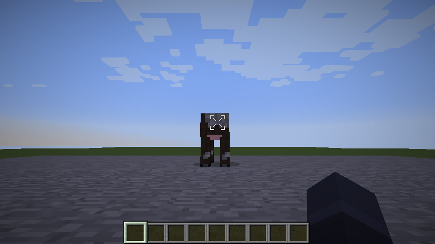
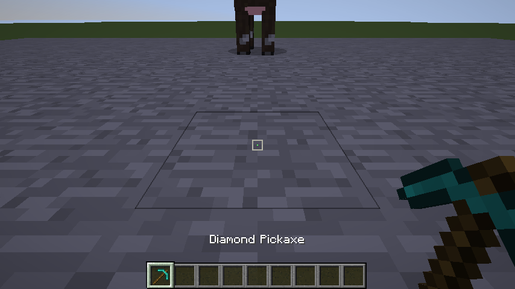
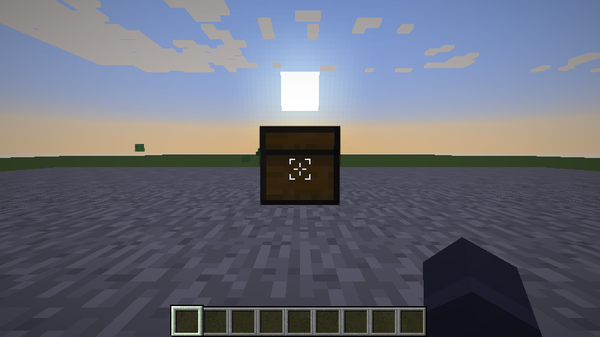
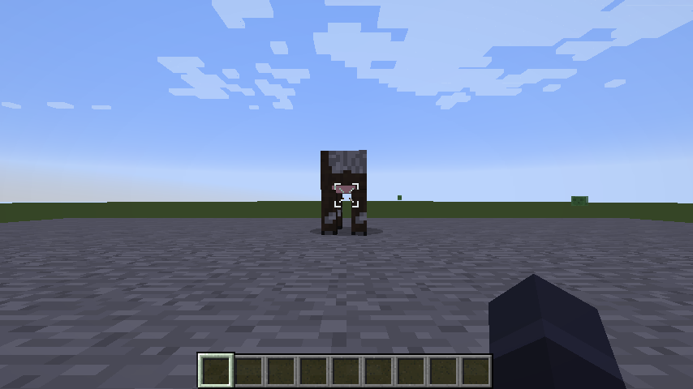
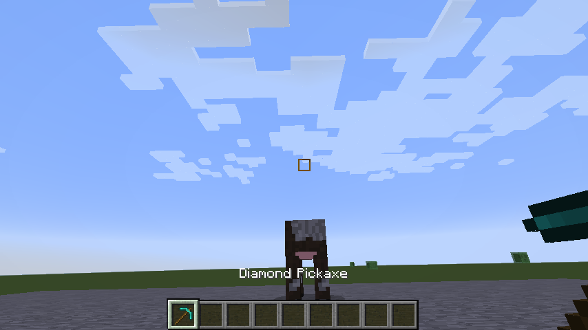
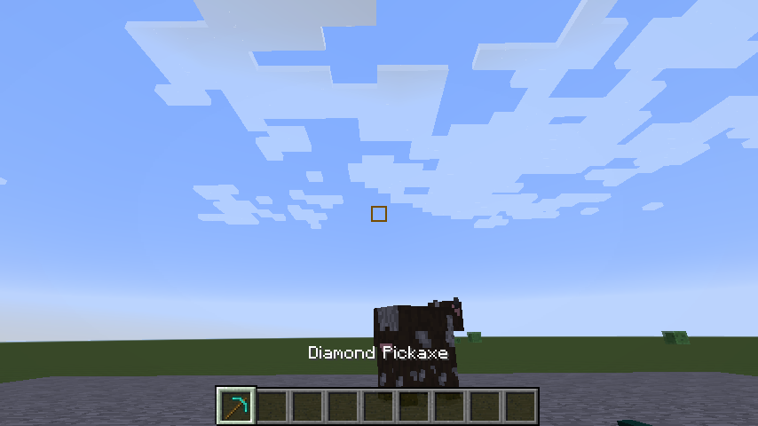
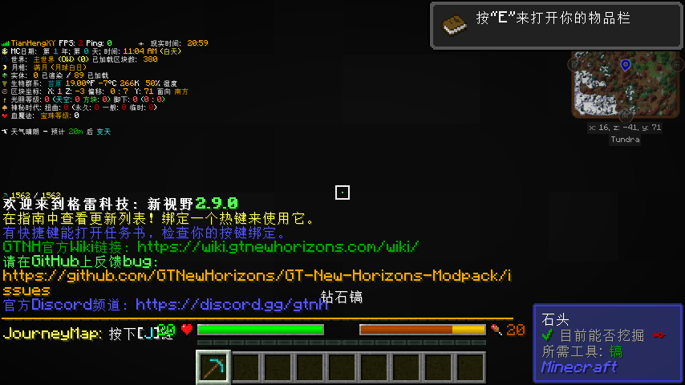
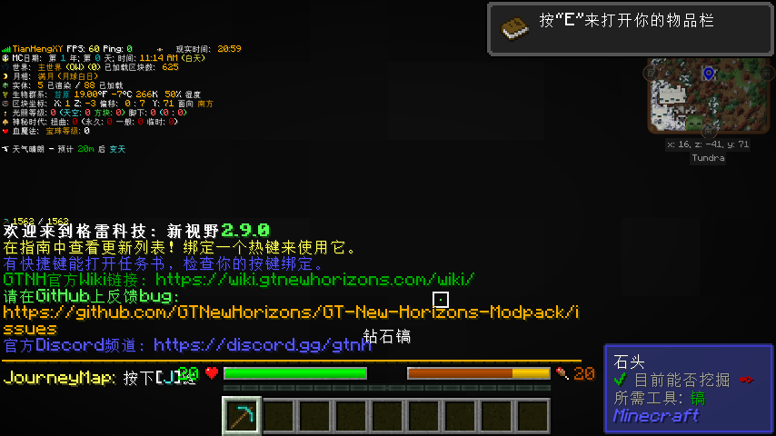

# Dynamic Crosshair 1.7.10 (GTNH 2.9.0)

把以下三个模组整合并移植到 Minecraft 1.7.10 / GT New Horizons 2.9.0，并兼容
[Crosshair-Selection](https://github.com/kanami2024520-jpg/Crosshair-Selection)：

- [DynamicCrosshair](https://github.com/Crendgrim/DynamicCrosshair) —— 根据准星指向动态切换准星样式
- [DynamicCrosshairCompat](https://github.com/Crendgrim/DynamicCrosshairCompat) —— 让模组方块/物品/实体参与判定
- [CrosshairBobbingMod](https://github.com/Krash220/CrosshairBobbingMod) —— 准星跟随视角晃动、攻击/进食/拉弓动画

目标环境是 1.7.10 Forge（GTNH 2.9.0 使用同一套 Forge 10.13.4.1614 API），**不依赖 GTNH 专属类**，
也不使用 Mixin，因此同一个 jar 可以在原版 1.7.10 与 GTNH 中加载。






## 功能

### 1. 动态准星（DynamicCrosshair）

- 主手/副手（1.7.10 无副手）、方块、实体三种上下文综合判定。
- 按状态使用不同样式：普通、指向方块、指向实体、手持方块、手持工具、手持近战武器、手持远程武器、
  手持投掷物、手持可用物品、可交互方块。
- 正确工具显示绿色圆点，错误工具显示红色圆点。
- 没有可交互目标时可隐藏准星（`dynamicCrosshair`）。
- 13 种样式精灵（直接沿用 DynamicCrosshair 的 15x15 素材）：`crosshair`、`cross-open`、
  `cross-open-diagonal`、`cross-diagonal-small`、`dot`、`circle`、`circle-large`、
  `square`、`square-large`、`diamond`、`diamond-large`、`brackets`、`brackets-round`、
  `brackets-bottom`、`brackets-top`、`lines`、`line-bottom`、`caret`、`empty`。
- 每个状态可单独配置 形状、ARGB 颜色、是否反色混合、是否合并绘制、缩放。
- 准星渲染使用原版的反色混合（`ONE_MINUS_DST_COLOR / ONE_MINUS_SRC_COLOR`），在雪地/天空等浅色背景上仍然可见。

### 2. 兼容层（DynamicCrosshairCompat 思路）

原版 DynamicCrosshairCompat 为上千个模组写了逐 Mixin 的兼容。1.7.10 端没有照搬这些 Mixin，而是用
**通用判定 + 显式 ID 列表 + 运行时 API** 覆盖同样的场景：

- 方块：有 TileEntity（GT 机器、箱子、机器方块等）或重写了 `onBlockActivated` → 视为可交互。
- 物品：`ItemBlock`、`ItemSword`、`ItemBow`、`ItemFood`、`ItemPotion`、投掷物、工具、
  `ItemHoe`/`ItemShears`/`ItemFlintAndSteel`/`ItemBucket`、护甲，以及重写了
  `onItemRightClick`/`onItemUse` 的模组物品 → 分类为可用/近战/远程/投掷等。
- 工具正确性：由 `getDigSpeed` 与 `getHarvestLevel`/`getHarvestTool` 计算；不需要工具的方块
  （泥土、沙子等）显示普通工具准星而不显示红点。
- 实体：掉落物、矿车/船、村民/可驯服/动物/马、其他生物分别判定。
- 配置文件里的 `compat.interactableBlocks` / `usableItems` 等列表可以按 `modid:name` 或
  `modid:name:meta` 强制指定，适合在没有专门代码时补齐 GTNH 里的特殊方块与物品。

### 3. 准星晃动（CrosshairBobbing）

- 视角晃动：按原版 `EntityRenderer.setupViewBobbing` 的变换矩阵把准星投影到晃动后的屏幕位置（默认开启）。
- 潜行：准星随潜行进度旋转（默认 -70°）。
- 切换物品：准星短暂下移/侧移。
- 攻击：命中时按伤害旋转并放大；暴击时 360° 旋转 + 双倍缩放。
- 进食：按使用进度旋转。
- 拉弓：按 Crosshair-Selection 的 gap 方式，8 个像素阶段，每级多露出 1 像素；斜十字用菱形缺口、正十字用加号缺口（不再用正方形遮挡），臂长不变、不缩放。
- 匠魂（Tinkers' Construct）弓/十字弩：通过 `IWindup.getWindupProgress` / `getMinWindupProgress`
  读取蓄力进度（反射，无编译依赖）；蓄力时准星缩放。
- 蓄力提示：AUTO 模式下**直接调用 Crosshair-Selection 自己的 `CrosshairHud.drawArrow/drawNumber`**
  （按它的 `bowChargeIndicator` 配置画 `↑` 或百分比），位置/颜色/阈值与 CS 完全一致；
  CS 未安装时才退回本模组的 `!`。`bobbing.crossbowIndicator` 可关。
- 所有效果可单独开关，并有整体强度倍率。




### 4. 与 Crosshair-Selection 兼容（保留颜色和流光）

Crosshair-Selection 用 Mixin 取消原版准星，并在 `RenderTickEvent` 里用片元着色器画它自己的准星。
本模组不修改它的 jar，只在运行时读取它的配置字段，然后：

- **形状**：使用本模组的动态样式（十字 / 斜十字 / 菱形 / 圆环 / 方框 / 括号……）。
- **颜色 + 流光**：完全采用 Crosshair-Selection 的 `colour`、`flow`（`hueStart`、`hueRange`、
  `saturation`、`brightness`、`opacity`、`speed`、`bandDensity`、`motion`、`direction`、`progress`）、
  `outline`/`outlineColour`/`outlineThickness` 与 `dot`/`dotColour`，用与它着色器相同的相位与
  空间色带公式逐格着色，所以颜色和流动的彩虹都会跟着它的设置走。
- **摇晃**：叠加本模组的视角晃动、潜行、切换物品、攻击与拉弓变换。
- 每帧在世界渲染阶段临时把它的 `enabled` 置为 false，绘制结束后的下一个 tick 恢复，
  保证屏幕上只有一个准星。

| 模式 | 行为 |
| --- | --- |
| `AUTO`（默认） | 接管：本模组形状 + 摇晃，Crosshair-Selection 的颜色与流光 |
| `YIELD` | 完全让出，保持 Crosshair-Selection 原样 |
| `FORCE_OURS` | 用本模组形状与自带颜色，忽略它的配色 |

`compat.adoptSelectionColours=false` 时，AUTO 仍接管形状和摇晃，但使用本模组样式颜色。
`compat.adoptSelectionOutline` 默认 **false**：Crosshair-Selection 的描边是为它自己的粗线着色器设计的，套在
15×15 细线像素精灵上会形成一圈难看黑边；需要时可以手动打开（GUI Compat 页的 “Adopt outline”）。

验证截图（1.7.10 + 模拟 Crosshair-Selection 配置字段的测试 Mod）：

- AUTO：[compat-auto.png](screenshots/compat-auto.png)（方框形状，颜色来自 CS 的流彩相位，不是白色）
- AUTO 面包：[compat-auto-food.png](screenshots/compat-auto-food.png)（圆环形状 + 流光颜色）
- YIELD：[compat-yield.png](screenshots/compat-yield.png)（CS 自己的红色准星）
- FORCE_OURS：[compat-force.png](screenshots/compat-force.png)（本模组白色准星）

接管期间 CS 自己的拉弓百分比提示会暂时隐藏（它的 `shouldRender()` 为 false）；本模组的拉弓缩放仍然生效。
即使 Crosshair-Selection 的类不存在也不会崩溃：所有反射都在 try/catch 中，检测失败时按独立模组工作。

## 平滑矢量渲染（需要 Crosshair-Selection）

AUTO 模式下、且安装了 Crosshair-Selection 时，可以打开 `compat.useSelectionRenderer`（默认开，GUI Compat 页
“平滑矢量渲染”）：不再绘制 15×15 像素精灵，而是把每种样式画成**程序化 SDF 形状**（和 CS 的十字同一思路），
逐像素平滑覆盖、没有像素锯齿；颜色/流彩/描边/蓄力 gap 全部沿用 CS 的配置。CS 不存在或关闭该选项时回退精灵渲染。

## 安装

1. 安装 Minecraft Forge 1.7.10（GTNH 2.9.0 已自带）。
2. 把 `DynamicCrosshair-1.7.10-1.1.8.jar` 放入 `mods/`。
3. 可选：安装 Crosshair-Selection；本模组会自动接管它的颜色/流光来绘制动态样式。
4. 启动游戏。客户端模组，专用服务器上不做事。

## 配置

- 配置文件：`config/dynamiccrosshair.cfg`（Forge Configuration，带注释）。
- 游戏内：按 **F9** 打开设置界面；也可以在 Mods 列表里点 Config。
- 设置界面有 General / Dynamic / Styles / Bobbing / Compat 五个页签：
  开关、策略循环、样式循环、颜色循环、缩放循环、恢复默认。
- Compat 页签里的 `Adopt colour/flow` 对应 `compat.adoptSelectionColours`：
  AUTO 接管时是否沿用 Crosshair-Selection 的颜色与流彩（关闭则用本模组样式颜色）。
- 键位可在 `Options → Controls` 里修改。

## 给模组作者的 API

```java
import mod.crend.dynamiccrosshair.api.*;
import mod.crend.dynamiccrosshair.crosshair.CrosshairContext;

@Mod.EventHandler
public void init(FMLInitializationEvent event) {
    DynamicCrosshairApi.register(new IInteractionProvider() {
        @Override public String getModId() { return "mymod"; }

        @Override public InteractionType getItemInteraction(CrosshairContext ctx) {
            if (ctx.held != null && ctx.held.getItem() == MyItems.WRENCH) {
                return InteractionType.USE_ITEM;
            }
            return null; // 不表态，交给下一个 provider / 通用判定
        }

        @Override public InteractionType getBlockInteraction(CrosshairContext ctx) {
            if (ctx.block == MyBlocks.MACHINE) return InteractionType.INTERACT_WITH_BLOCK;
            return null;
        }
    });
}
```

也可以不写代码，直接在配置里登记：

```
compat {
    S:interactableBlocks=mymod:machine,myothermod:panel
    S:usableItems=mymod:wrench
}
```

`InteractionType` 覆盖了 DynamicCrosshair API 的主要取值（`USE_ITEM`、`PLACE_BLOCK`、
`MELEE_WEAPON`、`RANGED_WEAPON`、`THROW_ITEM`、`TOOL`、`CORRECT_TOOL`、`INCORRECT_TOOL`、
`INTERACT_WITH_BLOCK`、`INTERACT_WITH_ENTITY`、`MOUNT_ENTITY`、`PICK_UP_ENTITY` 等）。

## 构建与测试

```bash
# 本机已缓存 GTNHGradle/RFG 依赖时（离线）
./run.bat build --offline

# 原版 1.7.10 客户端自动化测试（需要开发环境）
echo test > run/client/dynamiccrosshair-test.flag
./run.bat runClient --offline --no-daemon
```

测试钩子只在开发环境（launchwrapper 的 deobf 标记）且存在 `dynamiccrosshair-test.flag` 时启用，
或用 `-Ddynamiccrosshair.test.force=true` 显式强制；它只会操作自己创建的 `Dynamic Crosshair AutoTest` 世界，
遇到其它世界会立即停用，避免改动玩家存档；
它会自动创建平坦测试世界、摆设方块/箱子/牛，遍历 13 个准星状态并截图，最后关闭游戏。
截图位于 `run/client/screenshots/`，结果写入 `run/client/dynamiccrosshair-test-results.txt`。

已验证状态（1.7.10 Forge，2026-11-14）：

| 状态 | 判定 | 结果 |
| --- | --- | --- |
| 空中空手 | 无交互 | 隐藏准星 |
| 指向石头（空手） | `ON_BLOCK` | 十字 |
| 指向箱子（空手） | `ON_BLOCK + CAN_INTERACT` | 十字 + 括号 |
| 指向石头（钻石镐） | `HOLDING_TOOL + correct` | 方框 + 绿点 |
| 空中钻石剑 | `HOLDING_MELEE` | 十字 |
| 空中泥土 | `HOLDING_BLOCK` | 菱形 |
| 空中面包 | `HOLDING_USABLE` | 圆环 |
| 指向牛 | `ON_ENTITY + CAN_INTERACT` | 斜十字 + 括号 |
| 拉弓 | `HOLDING_RANGED` | 斜十字（缩放） |
| 晃动开/关 | 位移 dx=12.8,dy=7.2 / 0,0 | 准星偏移/居中 |
| 攻击 | 旋转 10.4°、缩放 1.36 | 可见旋转与放大 |
| 放置方块 | 准星阻尼抖动（旋转 + 位移，240ms） | 见 `state-12-place-shake`（bobbing 页可关） |
| 匠魂十字弩蓄满 | 调用 CS 的 `↑`/百分比；无 CS 时 `!` | 见 `tic-crossbow-cs.png`、`tic-crossbow.png` |
| 设置界面 | — | 五个页签可用 |
| AUTO + Crosshair-Selection | 形状/摇晃 + CS 颜色/流光 | 见 compat-auto.png、compat-auto-food.png |

### GTNH 2.9.0 实机验证（2026-11-14）

- 实例：PrismLauncher `GT_New_Horizons_2.9.0_Java_17-26`，247 个模组，Java 25，
  Angelica 2.2.43 + NotFine。
- 结果：**无崩溃**；13 个状态全部完成判定与绘制；准星和摇晃在 Angelica 的 HUD 缓存下正常显示。
- 截图：




- 崩溃修复（1.0.2）：GTNH 运行时方法名是 srg（如 `func_149727_a`），而反射只查 MCP 名；失败后把 `null`
  写进 `ConcurrentHashMap` 触发 NPE。现在同时尝试 MCP/srg 名，用 `Optional` 缓存失败结果，并在判定与渲染外层加了兜底。

## 与上游的差异 / 已知限制

- **没有移植 DynamicCrosshairCompat 的逐模组 Mixin**：改用通用判定 + ID 列表 + API。对 GTNH 的
  GT 机器、箱子类方块可以通过 TileEntity 自动识别；极特殊的方块/物品建议用配置列表或 API 指定。
- 1.7.10 没有副手、盾牌、十字弩、望远镜，相关配置项保留但不生效。
- 样式使用上游的静态 15x15 精灵，未实现上游 1.20+ 的动态样式注册表与数据生成。
- 准星样式是像素风固定尺寸，缩放范围 0.5–2.0。
- 测试钩子是开发期工具，生产环境不会激活。

## 许可

本整合移植以 **GPL-3.0** 发布（因为 CrosshairBobbing 是 GPL-3.0），详见 [LICENSE](LICENSE) 与
[NOTICE.md](NOTICE.md)。DynamicCrosshair / DynamicCrosshairCompat 的素材与设计来自 LGPL-3.0 上游，
Crosshair-Selection 为 MIT，均已在 NOTICE 中署名。
